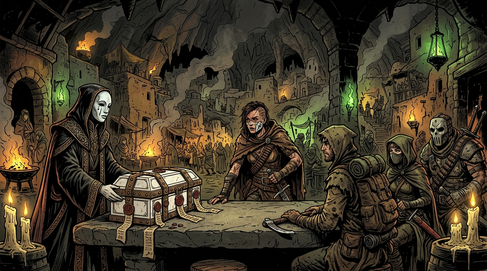
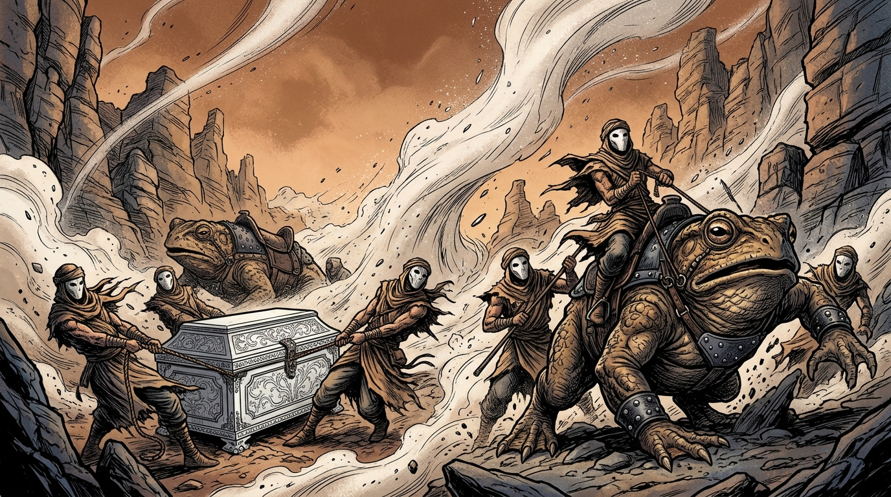
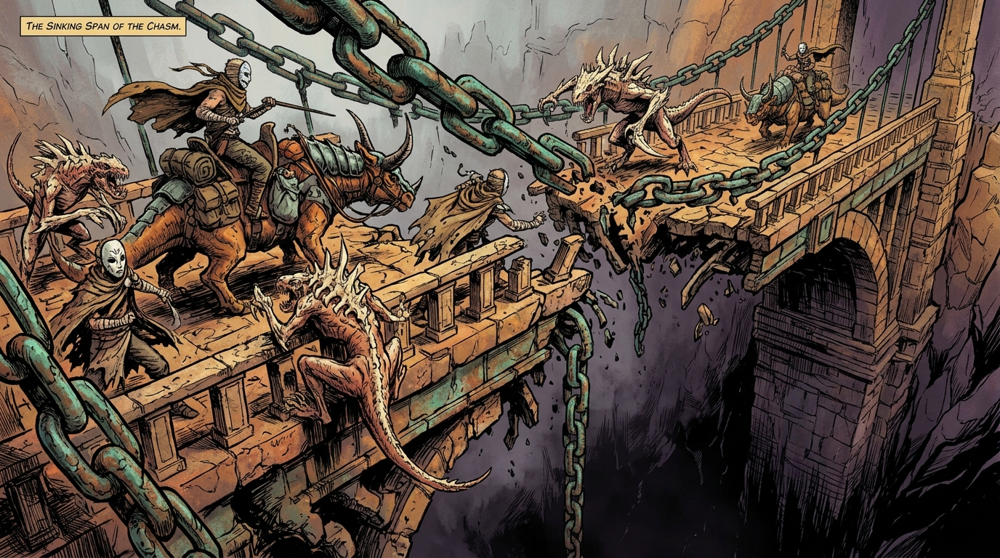
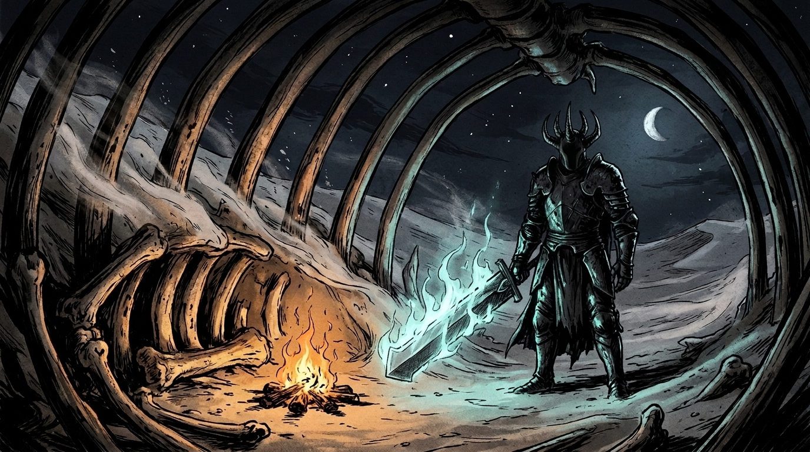
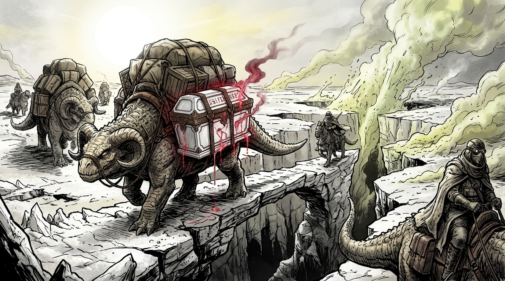
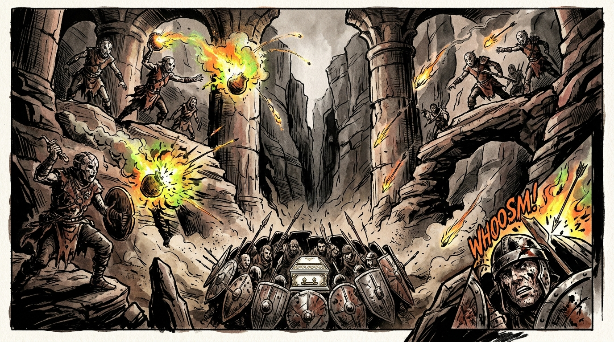
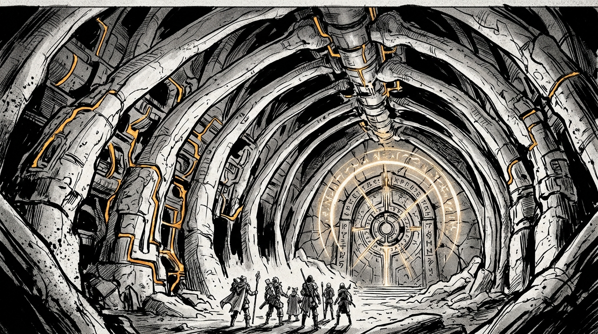
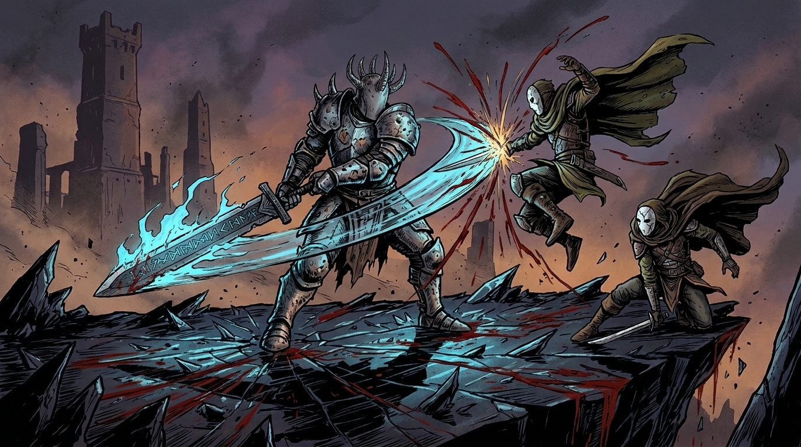
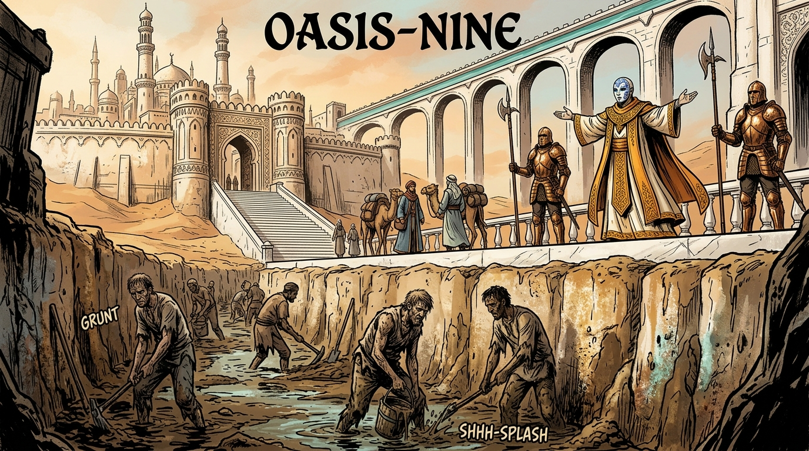
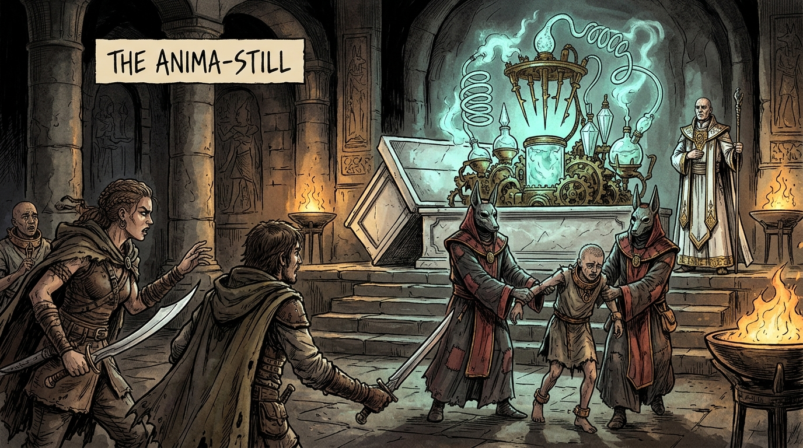

# THE ASH-CASKET OF OASIS-NINE
### A 3-Session Wasteland Campaign Adventure for *Blast or Bust*
**Inspired by the comic *Ten Earth Shattering Blows* by Nuclearpasta**  
**Game Design & Lore Adaptation: Federico Latini**  
**Narrative Design: /agency-narrative-designer • Visual Storytelling: /agency-visual-storyteller • Orchestration: /agency-agents-orchestrator**

---

## 💀 CAMPAIGN BRIEFING (REFEREE ONLY)

### The Premise
The party is hired at the border enclave of **Kiln-Hearth** by the gilded priesthood of the **Oasis-Nine Oligarchy**. Their mission: transport a heavy, hermetically sealed arcanotech reliquary known as **The White Casket** across the deadly Great Alkali Basin.

According to their employer, **High Prelate Orhan** (represented in Kiln-Hearth by Envoy Caelen), the Casket holds **Lady Sula**, the last living maiden of the pureblood dynastic line. Possessing an uncorrupted soul untouched by the ambient ash plague, she is supposedly being escorted to Oasis-Nine to perform the sacred **Rite of Rain** and awaken the city's perpetual springs. 

The party is bound by an absolute occult taboo: **The Casket must never be unsealed beneath the open sky**, or the ambient ash-curse will wither her spirit and dissolve her consecrated flesh within seconds.

Throughout the trek, the party is relentlessly hunted by **Varek the Faceless**, a towering warrior clad in pitted soul-iron armor and a five-horned black iron mask with no eye-slits, wielding an ancient rune-inscribed executioner brand.

---

### The Grand Twist: What the Players Took for Granted
1. **The "Pureblood Maiden" Myth**: There is no innocent girl inside the Casket. The entire story of the "fragile holy daughter" is a cynical myth engineered to ensure that honorable mercenaries will fight and die to protect it.
2. **The Living Soul-Crucible**: Inside the Casket rests an ancient magical apparatus known as **The Anima-Still (Model IX Soul-Crucible)**. It does not drink water to survive—**it consumes living human souls and spiritual vital force to magically transmute barren ash into pure drinking water** for the cloistered aristocrats of Oasis-Nine. Every month, dozens of indentured kiln-slaves are sacrificed into its runic alembics.
3. **The Nemesis Was Right**: Varek the Faceless is not an evil raider or a child-killer. He is a former temple paladin whose own daughter's spirit was ripped out and fed into the previous crucible during the last great drought. He was branded with forbidden iron, masked in eternal silence, and exiled into the dunes. He is not trying to murder an innocent—**he is trying to shatter the soul-devouring artifact before it consumes another generation of slaves**.

---

## 🎭 KEY DRAMATIS PERSONAE & VOICE PILLARS

### High Prelate Orhan (The Sovereign of Wells)
* **Visual**: Clad in floor-length white silk robes bordered with spun aurichalcum thread. Wears an immaculate smiling porcelain mask inlaid with powdered lapis lazuli. Hands are manicured, smelling of rosewater and camphor.
* **Voice Pillar**: Soft-spoken, courtly, paternal, and chillingly utilitarian. Never raises his voice; treats mass sacrifice as an obvious mathematical necessity for civilization.
* **Signature Quote**: *"Did you truly think heaven poured water upon this dead earth? Nature abandoned us a thousand years ago. We harvest the souls of the mud-dwellers so that nobility, beauty, and wisdom may survive."*

### Varek the Faceless (The Broken Paladin)
* **Visual**: Seven feet of hardened muscle and scorched soul-iron plate welded with screaming relief visages. Wears a seamless five-horned iron helm forged without eye-slits; sees through the occult aura of souls. Wields a colossal runic executioner greatsword trailing pale-blue corpse fire.
* **Voice Pillar**: A voice like grinding millstones, muffled through iron plates. Direct, sorrowful, ferocious, stripped of all polite pretense.
* **Signature Quote**: *"You carried a slaughterhouse upon your backs across the wastes, and you called it devotion. If your eyes are blind to the truth, then my blade will open them."*

### Envoy Caelen (The Silk Broker)
* **Visual**: Slender envoy wearing a porcelain mask depicting a weeping angel with gilded tears. Carries an ivory ledger and speaks with nervous, fluttering hand gestures.
* **Voice Pillar**: Solicitous, desperate, obsequious, constantly reminding the party of the sanctity of their oath.

---

## 🗺️ CAMPAIGN ROADMAP (10 SCENES ACROSS 3 SESSIONS)

```
SESSION 1: THE WHITE CHASM (Exploration & Nature's Wrath)
├── Scene 1: The Contract at Kiln-Hearth (The Vow & The Warded Reliquary)
├── Scene 2: The Screaming Sirocco (Force of Nature: Razor-Glass Ash Storm)
├── Scene 3: The Sinking Span of the Chasm (Collapsing Runic Bridge & Saur-Stalkers)
└── Scene 4: The Stalker in the Ash (First Brush with Varek the Faceless)

SESSION 2: THE IRON BASIN (Wasteland Hazards & Ancient Sorcery)
├── Scene 5: The Alkali Sinks (Force of Nature: Boiling Caustic Lye Flats)
├── Scene 6: Ambush in the Siphon Canyon (The Cursed Scrap-Cult)
└── Scene 7: The Tomb of the Stone Colossus (Ancient Petrified Golem-Shrine)

SESSION 3: THE CITADEL & THE SHATTERED TRUTH (The Climax & The Twist)
├── Scene 8: Blood upon the Vitrified Ridge (The Boss Duel with Varek)
├── Scene 9: The Ivory Spire of Oasis-Nine (Sanctuary & The Unsealing Liturgy)
└── Scene 10: The Anima-Still Awakens (The Reveal & The Moral Crucible)
```

---

# 🏜️ SESSION 1: THE WHITE CHASM

```
Theme: The Long Departure into the Dead World
Tone: Bleak optimism turning into oppressive paranoia
Rule Focus: Travel, Environmental Hazards, Tension Die Escalation
```

---

### Scene 1: The Contract at Kiln-Hearth



> 📜 **READ-ALOUD / NARRATOR INTRO**  
> *"Kiln-Hearth chokes beneath the inverted bell of an ancient volcanic caldera. Below the soot-streaked basalt vaults, the heat never dies. In the private cellar of the Black Amphora, the air hangs heavy with sulfur, cedar incense, and the fat grease of tallow tapers.  
> Before you stands Envoy Caelen. His face is hidden behind an immaculate porcelain mask of a weeping angel, its hollow cheeks traced in leaf gold. Across the basalt trestle table rests your cargo: a six-foot oblong reliquary of flawless white porcelain, bound in heavy hoops of warded bronze and pinned with vermilion talismans. Whenever your knuckles brush its glazed flank, a faint, rhythmic vibration hums through the stone—like the pulse of a caged bird.  
> 'Four hundred leagues across the White Trench,' Caelen whispers, his silk sleeves trembling. 'Protect Lady Sula with your breath and blood. Break not the seal beneath the sky, lest the ash-curse turn her divine blood to dust. Oasis-Nine awaits.'"*

#### The Situation & Exploration
* **The Payment**: Envoy Caelen hands each adventurer 2 ceramic water-chits upfront (each redeemable for 10 gallons of filtered spring water or traded as currency) and promissory scrolls stamped with the lapis crest of High Prelate Orhan, promising lifelong terrace estates in Oasis-Nine.
* **The Cargo (The White Casket)**:
  * Dimensions: 6.5 ft long, 2.5 ft wide, weighing roughly 280 lbs.
  * Secured to an reinforced sled harnessed to two heavy horned toad-saurs.
  * A tiny oval scrying pane of thick crystal is set into the head of the lid, but it is perpetually occluded by churning white mist and faint, luminescent condensation.
* **Foreshadowing Clue #1 (The Runic Sigils)**:
  * Any character inspecting the bronze binding hoops and succeeding on a **KNO 14+** test recognizes that the carved glyphs are **not** prayers of divine healing, cryogenic preservation, or bodily protection. They are **proto-sorcerous compression wards** engineered to trap volatile spiritual energies and prevent psychic leakage.
* **Departure**: As the party ascends the winding spiral road out of Kiln-Hearth into the blistering blinding white desert, the GM places a **d4** in the center of the table: **The Tension Die is born.**

---

### Scene 2: The Screaming Sirocco (Force of Nature)



> 📜 **READ-ALOUD / NARRATOR INTRO**  
> *"By the fourth day of travel, the jagged red walls of the Great Trench close in like the ribs of a butchered titan. At noon, the sun turns the color of hammered copper. The wind stops. Then comes the sound—not a howl, but a high-pitched, metallic shriek that rattles your teeth.  
> From the north, a wall of white ash five hundred feet high sweeps across the canyon floor, chewing the stone to powder. It is the Screaming Sirocco: a tempest of vitrified volcanic glass that flays skin from bone in seconds. Your toad-saurs bellow in terror, digging their hooked claws into the gravel as the sled begins to lift on the rising gale!"*

#### Environmental Hazard Mechanics
* **The Danger**: The storm threatens to shred clothing, blind the pack beasts, and sweep the sled containing the White Casket over the canyon lip.
* **Obstacle Statblock**:

> #### OBSTACLE: THE SCREAMING SIROCCO
> * **Nature**: Environmental Cataclysm (Physical / Mental)
> * **Threshold**: **Hard (17+)**
> * **Health Pool**: **26 HP**
> * **Viable Approaches**:
>   * **COS (Body Shield)**: Throwing oneself against the sled ropes, anchoring stakes with raw muscle, and shielding the beasts with heavy canvas and leather cloaks.
>   * **WIT (Wind-Reading)**: Discerning vortex patterns in the dust wall to steer the mounts into an undercut basalt cave before the main glass-front hits.
> * **Counterattack (if Alive / on Bust)**: *Glass-Flayed Flesh*. Razor-sharp vitreous dust penetrates respirators and cloaks: deals **1d6 HP** to the acting player and all aiding allies (and on a **Bust**, immediately step up the Tension Die by 1 tier!).
> * **Escalation Clock [ 3 Ticks ]**: Every round where no progress is made against the storm's HP adds 1 tick. At 3 ticks, a violent gust snaps a tie-down strap: 1 waterskin bursts or 1 non-relic item is torn away into the abyss.

---

### Scene 3: The Sinking Span of the Chasm



> 📜 **READ-ALOUD / NARRATOR INTRO**  
> *"The trench terminates at an eighty-foot rift plunging into subterranean steam vents. The only passage is the Broken Aqueduct: an ancient span of petrified timber and ironwood flagstones suspended by gargantuan green-encrusted bronze chains forged by an extinct civilization.  
> As the heavy toad-saurs lumber onto the bridge, the ancient stone moans. Ironwood beams splinter with gunshot cracks. Worse still, the rhythmic pulse of the White Casket has awakened the chasm: three massive Bone-Crested Carrion-Saurs, their pale reptilian bodies scarred by ash-rot, scramble up the cliff face on hooked talons, jaws snapping for fresh meat!"*

#### Tactical Encounter Mechanics
* **The Dual Danger**: The party must simultaneously prevent the bridge chains from snapping under the strain and drive back the ravenous pack of saurs before they flip the sled.
* **Obstacle Statblock**:

> #### OBSTACLE: CRUMBLING SPAN & CARRION-SAURS
> * **Nature**: Hybrid Terrain & Savage Beast Obstacle
> * **Threshold**: **Moderate (14+)**
> * **Health Pool**: **22 HP**
> * **Viable Approaches**:
>   * **STR / AGI**: Engaging the saurs at close quarters, severing jaw tendons, or vaulting across collapsing flagstones to pin the beasts against the cliff.
>   * **KNO / PRE**: Reciting archaic harmonic words to re-tension the ancient bronze anchor-links, or unleashing an ear-splitting war-cry that terrifies the primitive beasts back into the dark.
> * **Counterattack (if Alive / on Bust)**: *Snapping Bronze & Saur Maul*. A rusted chain-link snaps with a deafening crack. Flying metal shards and snapping jaws deal **1d8 HP damage** and knock the character prone on the verge of the 80-foot drop.
> * **Aiding Highlight**: If a player declares they will brace the bridge chains so another can land an unhindered blow, apply the **Module 2 Aiding Rules** (granting lower threshold or reroll, but sharing consequences if busted).

---

### Scene 4: The Stalker in the Ash (First Brush with the Nemesis)



> 📜 **READ-ALOUD / NARRATOR INTRO**  
> *"Night falls over the White Chasm with the chill of a crypt. You make camp within the hollow cranium of a colossal petrified leviathan, its ivory eye-sockets framing the dead desert sky. The embers of your scrap-wood fire cast jittering shadows across the white porcelain of the Casket.  
> Without warning, the camp's warding stones sizzle and crack.  
> Striding through the swirling ash comes a silhouette carved from nightmare. Seven feet tall, encased in soot-blackened soul-iron plate etched with screaming human faces. A seamless iron helm with five cruel horns covers his head—completely smooth, lacking eye-slits or mouth-grille. In his gauntleted hand, he drags a six-foot executioner's brand, its ancient runes radiating a sickly blue corpse-fire.  
> He does not look at you. His faceless visor fixes upon the White Casket.  
> 'You bleed for a lie, wanderers,' a voice rumbles from deep within his chest, sounding like stones grinding in an iron churn. 'Open the porcelain grave. Look upon the god you carry before you die for its hunger.'"*

#### The Nemesis Reconnaissance
* **Varek's Objective**: Varek is not here to butcher the party tonight; he wants them to renounce their contract or open the casket willingly. When they refuse, he attacks with overwhelming, methodical precision to test their mettle.
* **Obstacle Statblock**:

> #### BOSS OBSTACLE: VAREK THE FACELESS (SKIRMISH FORM)
> * **Nature**: Nemesis Combatant (Physical / Intimidation)
> * **Threshold**: **Extreme (20+)**
> * **Health Pool**: **18 HP**
> * **Viable Approaches**:
>   * **STR / COS**: Bracing against his crushing overhead sword cleaves; redirecting his momentum into the leviathan's petrified bone pillars.
>   * **WIT / AGI**: Dodging through his blind spots (exploiting his sensory reliance on soul-auras) and severing his sword-arm pauldron straps.
> * **Counterattack (if Alive / on Bust)**: *Shockwave of Soul-Fire*. The blue runes of his blade flare, discharging a shockwave that deals **1d10 damage** (player chooses HP or MP) and sends the character crashing into the campfire.
> * **Withdrawal**: Once the party deals 18 HP to Varek, he plants his greatsword into the sand, murmuring: *"Turn back, hirelings. Or your bones will pave the temple gutters."* He crushes an alchemical smoke-globe, vanishing into the howling ash mist like a phantom.
* **End of Session 1 Check**: The GM rolls the current **Tension Die** on the Wasteland Threat Table and resets it to **d4**!

---

# ⚱️ SESSION 2: THE IRON BASIN

```
Theme: The Desolation of Ancient Sorcery
Tone: Claustrophobia under wide skies, mounting dread, physical decay
Rule Focus: Resource Strain, Module 2 Adjective/Hazard Generation, Moral Foreboding
```

---

### Scene 5: The Alkali Sinks (Force of Nature)



> 📜 **READ-ALOUD / NARRATOR INTRO**  
> *"The trench opens into the Great Alkali Basin: a blinding, blinding expanse of white chemical crust stretching to every horizon under a sun that bleaches color from the world. It looks as solid as marble, but beneath your beasts' footpads, the ground feels sickeningly spongy.  
> Sulfur fumaroles hiss like serpents. Beneath the fragile salt crust boils a subterranean sea of caustic chemical lye and liquefied quicksilver.  
> As the midday heat spikes, the Casket begins to shudder. Its internal cooling wards flicker erratically. From beneath the bronze rim, a single drop of condensate oozes and splashes onto the salt crust with an angry hiss.  
> It is not melted ice. It is thick, iridescent, copper-smelling crimson fluid—spirit-blood—and where it touches the lye, the salt smokes like ignited brimstone."*

#### Hazard Mechanics & Discovery
* **The Environmental Hazard**: The crust is softening under the midday sun. Geysers of scalding lye threaten to swallow the heavy sled.
* **Foreshadowing Clue #2 (The Leaking Essence)**:
  * Any Cleric, Arcanist, or character checking the leak with **WIT 14+** realizes that whatever is inside the Casket is **producing** spiritual waste heat through intense metaphysical digestion. A living mortal maiden could not generate this aura without incinerating her own organs.
* **Obstacle Statblock**:

> #### OBSTACLE: THE BOILING ALKALI CRUST
> * **Nature**: Environmental Hazard (Physical / Navigational)
> * **Threshold**: **Hard (17+)**
> * **Health Pool**: **24 HP**
> * **Viable Approaches**:
>   * **AGI**: Swiftly leading the pack-saurs across narrow, dormant salt ridges, leaping over bubbling fissures before they cave in.
>   * **WIT**: Analyzing heat shimmers and salt coloration to map safe basalt stepping-stones across the boiling marsh.
> * **Counterattack (if Alive / on Bust)**: *Lye Geyser*. A pressurized jet of boiling alkaline sludge erupts underfoot: deals **1d8 HP damage** and permanently ruins 1 waterskin or piece of footwear/armor strapping.

---

### Scene 6: Ambush in the Siphon Canyon



> 📜 **READ-ALOUD / NARRATOR INTRO**  
> *"To bypass the central boiling sinks, your route cuts through Siphon Canyon: a deep sandstone gorge lined with towering petrified aqueduct columns.  
> A whistle echoes off the canyon walls. High above, on ancient maintenance catwalks, figures emerge. They are the Kiln-Scrap Cult: desperate ash-dwellers whose faces are hidden beneath cracked ceramic masks welded together with melted lead. Their skin is covered in ritual scars depicting dripping water-drops.  
> 'The White Vessel!' their leader screeches, brandishing a hooked polearm. 'The Water-Eater is ours! Smelt the bronze! Drink its blood!'  
> Clay pots tumble from the heights, bursting on the rocks into sheets of alchemical white fire. Boulders crash down to block the path ahead and behind!"*

#### Combat & Ambush Mechanics
* **Tactical Situation**: The party is pinned in a kill-zone. They must break the boulder barricade or suppress the snipers on the catwalks while keeping the sled from being consumed by alchemical fire.
* **Obstacle Statblock**:

> #### OBSTACLE: KILN-SCRAP CANYON AMBUSH
> * **Nature**: Coordinated Hostile Ambush (Hybrid)
> * **Threshold**: **Moderate (14+)**
> * **Health Pool**: **28 HP**
> * **Viable Approaches**:
>   * **STR**: Heaving boulders out of the choke-point to force the sled through, or hurling heavy iron javelins up into the catwalks.
>   * **PRE**: Brandishing holy relics, unleashing roaring war-shouts, or calling upon the dreaded authority of Oasis-Nine to shatter the fragile morale of the cultists.
> * **Counterattack (if Alive / on Bust)**: *Alchemical Fire-Pot*. A bursting clay vessel douses a character in clinging chemical flame: deals **1d6 HP damage** and inflicts the *Burning* condition (disadvantage on all physical rolls until an action is spent smothering the fire).
> * **Interrogation Opportunity**: If any cultist is captured alive, they weep through their cracked masks: *"We wanted to destroy it! It drinks people! In the old war, it drank three villages to fill the high fountains of the masters!"*

---

### Scene 7: The Tomb of the Stone Colossus



> 📜 **READ-ALOUD / NARRATOR INTRO**  
> *"Fleeing the canyon heat, you take refuge in the half-buried remains of an ancient wonder: the Slumbering Titan. It is a two-hundred-foot stone golem carved by the First Builders, felled ages ago and now jutting from the sandstone cliff like a petrified cathedral.  
> Inside, the air is dead cold and smells of oxidized brass. Massive ribs of carved granite arch hundreds of feet above. Along the stone columns run intricate conduits filled with pulsating, liquid aurichalcum that casts a warm golden glow across the floor.  
> Deep in the golem's sternum chamber, the way north is barred by a monumental circular vault door covered in spinning runic rings. Beside it stands an archaic offering pedestal carved with ancient hieroglyphs.  
> When the White Casket is dragged near the altar, the runes on both the pedestal and the reliquary flare in violent unison, as if recognizing each other across millennia."*

#### Lore Decryption & The Final Warning
* **Foreshadowing Clue #3 (The Altar Translation)**:
  * Characters examining the pedestal can translate the ancient glyphs with **KNO 14+**:  
    `"VESSEL ARCHETYPE IX: REVERSE-ENTROPIC SPIRITUAL ALAMBIC. TRANSFORMS LIVING HUMORS AND ANIMA-FORCE INTO PURE HYDRAULIC ELEMENT. THRESHOLD REQUIREMENT: ONE SOUL PER THOUSAND AMPHORAE."`
  * The realization becomes undeniable: **The Casket is not carrying a passenger. The Casket is a machine.**
* **Obstacle Statblock**:

> #### OBSTACLE: THE TITAN’S WARDED PORTAL
> * **Nature**: Ancient Sorcerous Vault Door
> * **Threshold**: **Hard (17+)**
> * **Health Pool**: **20 HP**
> * **Viable Approaches**:
>   * **KNO**: Deciphering the harmonic resonance sequence of the spinning runic rings to disarm the vault locks safely.
>   * **STR / COS**: Jamming iron bars into the counterweight pulleys and heaving against centuries of mineral calcification.
> * **Counterattack (if Alive / on Bust)**: *Arcane Backlash*. Aurichalcum arcs through the chamber like golden lightning: deals **1d8 MP damage** to the character's mind and steps up the Tension Die!
> * **End of Session 2 Check**: The GM rolls the current **Tension Die** on the Wasteland Threat Table and resets it to **d4**!

---

# ⚔️ SESSION 3: THE CITADEL & THE SHATTERED TRUTH

```
Theme: The Mirage of Civilization, The Shattering of Faith
Tone: Opulent cruelty, tragic confrontation, explosive rebellion
Rule Focus: Boss Tactics, Moral Crucible, High-Stakes Climax
```

---

### Scene 8: Blood upon the Vitrified Ridge (The Nemesis Climax)



> 📜 **READ-ALOUD / NARRATOR INTRO**  
> *"You emerge onto the Vitrified Ridge: a jagged crest of black obsidian glass, melted smooth during the ancient wars of god-kings. Below, in the basin beyond, gleams Oasis-Nine—a mirage of white marble spires, emerald gardens, and cascading waterfalls shining beneath the evening sun. Deliverance is within sight.  
> But waiting at the narrow apex of the glass ridge stands Varek the Faceless.  
> He stands alone. His massive greatsword is driven deep into the black glass. His tattered black mantle snaps in the gale. Through the five horns of his blind iron visor, a low, sorrowful hymn echoes.  
> 'Here your journey ends,' Varek says, his gauntleted hand wrapping around the hilt of his executioner brand. The pale-blue runes flare with blinding corpse-light. 'You carried a slaughterhouse across the desert and called it devotion. If your eyes will not open to the truth, then my blade will open them. The machine dies today—or you die defending it.'"*

#### The Boss Fight Mechanics
* **Setting the Stage**: The obsidian floor is slick as wet ice. Every step threatens to slide.
* **Obstacle Statblock**:

> #### BOSS OBSTACLE: VAREK THE FACELESS (UNLEASHED)
> * **Nature**: Nemesis Combatant (Physical / Soul-Arcana)
> * **Threshold**: **Hard (17+)** *(Drops to 14+ if the party targets the damaged binding runes behind his armor pauldrons)*
> * **Health Pool**: **35 HP** • **Mental Composure**: **20 MP**
> * **Viable Approaches**:
>   * **STR / AGI**: Slipping beneath his sweeping horizontal strikes on the slick glass to stab at unarmored joints behind his knees.
>   * **PRE / KNO**: Reciting the temple vows of the old paladin orders, naming his lost daughter (if discovered in lore), or dispelling the soul-wards shielding his plate.
> * **Counterattack (if Alive / on Bust)**: *Soul-Cleaving Cleave*. His greatsword trails an arc of white-hot spiritual fire: deals **2d8 damage** (player chooses HP or MP) and **permanently shatters an equipped non-relic weapon or shield**!

#### The Tragic Defeat of Varek
* When reduced to 0 HP, Varek does not fall into anger. He collapses onto one knee, the greatsword slipping from his cracked gauntlets. Blood darkens the obsidian glass beneath his mask.
* With trembling strength, he grips the forearm of the nearest player character:
  > *"Listen to me... with your own ears... not their lies... When you reach the high hall... look into the cradle before you give it to Orhan... Do not let them feed another child to its mouth... Break the bronze... break... the... still..."*
* His head bows. His breath ceases. The party stands victorious on the glass ridge, with the towers of Oasis-Nine shining before them.

---

### Scene 9: The Ivory Spire of Oasis-Nine



> 📜 **READ-ALOUD / NARRATOR INTRO**  
> *"The grand gates of Oasis-Nine are monumental arches carved from polished mammoth-bone and white alabaster. Inside, the city is a paradisiacal fever dream: terraces of purple bougainvillea, open marble baths of cold spring water, and aristocrats strolling in feather cloaks and smiling golden masks.  
> But your eyes see the gutters.  
> Outside the walls, in the stagnant mud trenches beneath the drainage sluices, thousands of emaciated, unmasked kiln-slaves toil in rags under the whips of bronze-clad overseers, digging ash canals with bare fingers.  
> High Prelate Orhan descends the grand marble staircase to meet you. His robes are spun from white spidersilk and dusted with gold. His smiling porcelain mask, inlaid with deep lapis lazuli, tilts in gracious benediction.  
> 'Blessed travelers,' the Prelate purrs, his hands outstretched in blessing. 'You have preserved the sacred light. Bring the Holy Maiden to the Inner Sanctum. Today, the heavens will open!'"*

#### The Reception & The Infiltration
* **The Reward**: Orhan presents the party with velvet pouches heavy with stamped platinum coins and sealed property deeds to sun-drenched estates on the First Terrace.
* **The Liturgy Preparation**: Orhan insists that only the holy priests may accompany the Casket into the Inner Sanctum for the "Awakening Liturgy." The party is invited to feast in the outer banquet hall.
* **The Suspicion**: Any player watching the procession through the bronze grates or rolling **WIT 14+** notices:
  * No handmaidens, flowers, or soft cushions are being carried into the sanctum for an awakening maiden.
  * Instead, four temple executioners carry **thick bronze chains**, **sponges of embalming vinegar**, and **drainage basins**.
  * In the center of the sanctum floor sits a sunken iron drain surrounded by dried, scrubbed blood-gutters.

---

### Scene 10: The Anima-Still Awakens (The Grand Climax)



> 📜 **READ-ALOUD / NARRATOR INTRO**  
> *"Whether you force the heavy bronze doors, use stealth to scale the balconies, or demanded entry as sworn guardians, you enter the Inner Sanctum.  
> Incense curls thick as shroud-cloth.  
> The bronze bands of the White Casket lie discarded on the marble flagstones. The porcelain lid is swung wide open.  
> There is no maiden inside.  
> Resting upon the purple velvet cradle is a monstrous, intricate apparatus of spun gold, coiled crystal alembics, and razor-tipped extraction needles that pulse with an insatiable spiritual hunger: **The Anima-Still**.  
> In the pit before the machine, temple guards drag two young kiln-slaves—a boy and a girl barely fifteen years old, heads shaven, shivering in rusted iron collars. Masked acolytes raise the needle-harnesses, preparing to drive them into the children's spinal columns to ignite the hydraulic transmutation.  
> High Prelate Orhan turns slowly toward you. His smiling porcelain face looks serenely down upon your drawn weapons.  
> 'You look horrified, wanderers,' the Prelate sighs, adjusting his gilded silk stole. 'Did you imagine the gods gave water to this wretched earth for free? Nature cursed this world to dry bones. We take the wretched dregs of the mud-trenches and transmute their worthless breaths into liquid life. Because of this crucible, civilization endures.  
> Take your gold. Take your palaces. Put on your golden masks, and walk away. Or die here, and your souls will fill tomorrow's fountains.'"*

---

## ⚖️ THE MORAL CRUCIBLE (THE FINAL DECISION)

The entire campaign pivots on what the party does in this single, indelible moment:

### Option A: The Aristocratic Compromise (Cynical Survival)
* The players sheath their weapons, accept their purses of platinum, and turn their backs.
* The acolytes plunge the needles into the children's spines. The Anima-Still roars to life with blinding cyan soul-fire. Through the high palace windows, the sound of cheering crowds echoes as crystal-clear water gushes from the mouths of the marble lions into the high terraces.
* **The Ending Scene**: High Prelate Orhan personally places **Smiling Golden Porcelain Masks** over the faces of the adventurers. They are now lords of Oasis-Nine. They have land, endless water, and slaves of their own. But as they raise their goblets, they know that every drop they drink tasted of the dying cries of the children in the pit.

---

### Option B: Shattering the Soul-Crucible (The Rebel’s Blast)
* The players roar their defiance, draw their weapons, and charge the altar to smash the machine and slay the Prelate!
* **Final Climactic Encounter**:

> #### CLIMAX OBSTACLE: PRELATE ORHAN & THE TEMPLE GUARD
> * **Nature**: Elite Sorcerous Combat & Boss Encounter
> * **Threshold**: **Extreme (19+)**
> * **Health Pool**: **32 HP**
> * **Viable Approaches**:
>   * **STR / AGI**: Cutting down the bronze-armored temple guards, leaping over the sacrificial pit, and driving a blade through Orhan's silk vestments.
>   * **KNO / WIT**: Targeting the fragile alchemical crystal conduits of the Anima-Still, reversing the hydraulic pressure to detonate the machine in a blast of pressurized steam and holy force.
> * **Counterattack (if Alive / on Bust)**: *Lapis Sunfire & Guard Halberds*. Orhan's sorcerous ring unleashes an explosion of searing golden flame, dealing **2d10 HP damage** to the acting party!

#### The Ending of the Rebel:
* The Anima-Still is smashed into shattered crystal shards and crumpled gold filigree.
* The high fountains cough, sputter, and **run completely dry**. Panic spreads through the marble palaces.
* Outside the walls, the tens of thousands of slaves look up at the dry towers. The whips stop. In an unstoppable tide of bronze tools and picks, the oppressed rise to storm the gates.
* The party must cut their way out of the burning city, fleeing back into the great white desert as legendary heretics—carrying **Varek's five-horned iron helm** at their saddle-horns as a symbol of the lone warrior who dared to tell them the truth.

---

## 🎲 REFEREE MASTER QUICK-REFERENCE MATRIX

| Scene | Scene Name & Theme | Core Focus | Primary Attributes | Target Threshold | Counterattack (if Alive) / Bust |
| :---: | :--- | :--- | :---: | :---: | :--- |
| **1** | **The Contract at Kiln-Hearth** | Contract, Inspection & Vow | **KNO / PRE** | **14+** | Misses warning sigils; Tension starts at d4 |
| **2** | **The Screaming Sirocco** | Glass-Dust Storm (Nature) | **COS / WIT** | **17+** | Glass-Flayed Flesh (1d6 HP) + Tension die steps up |
| **3** | **The Sinking Span** | Collapsing Bridge & Beasts | **STR / AGI** | **14+** | Snapping chain; 1d8 HP & knocked prone on the brink |
| **4** | **The Stalker in the Ash** | First Brush with Varek | **STR / PRE** | **20+** | Rune-blade shockwave (1d10 dmg) & ominous warning |
| **5** | **The Alkali Sinks** | Boiling Caustic Lye (Nature) | **AGI / WIT** | **17+** | Caustic geyser (1d8 HP) & gear ruined; leaks spirit-blood |
| **6** | **Ambush in Siphon Canyon** | Kiln-Scrap Cult Ambush | **STR / PRE** | **14+** | Alchemical fire-pots (1d6 HP + catches fire) |
| **7** | **Tomb of the Stone Colossus** | Ancient Titan & Vault Portal | **KNO / STR** | **17+** | Arcane Backlash (1d8 MP) & reads soul-sacrifice lore |
| **8** | **Blood upon Vitrified Ridge** | Duel with Varek the Faceless | **STR / KNO** | **17+** | Soul-cleaving brand (2d8 dmg & weapon shattered); dying plea |
| **9** | **The Ivory Spire of Oasis-Nine** | Gate Reception & Blood Gutters | **PRE / WIT** | **14+** | Spots executioner tools & sacrificial blood drains |
| **10** | **The Anima-Still Awakens** | The Crucible Reveal & Revolt | **Any (Combat)** | **19+** | Orhan's sunfire (2d10 HP); Fate of Oasis-Nine decided |

---
*Blast or Bust TTRPG &bull; The Ash-Casket of Oasis-Nine &bull; Module & Rules by Federico Latini*
